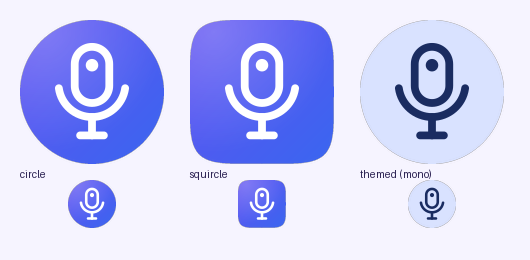
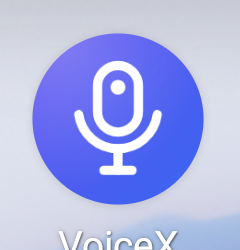

# VoiceX build notes

VoiceX 1.0.0 (versionCode 1) · built 2026-11-03 on Ubuntu 24.04 x86_64.

## Toolchain

| Item | Version |
|---|---|
| compileSdk / targetSdk | **37** (platform `android-37.0` = Android 17, installed) |
| minSdk | 31 |
| ABI | arm64-v8a only |
| AGP / Gradle | 9.4.1 / 9.6.0 (wrapper, checksum-pinned) |
| Kotlin / Compose BOM | 2.3.20 / 2026.03.01 (Material 3) |
| NDK | **30.0.16248370** (pinned in `app/build.gradle.kts`) |
| CMake | 4.1.2 (SDK package) |
| JDK | OpenJDK 17.0.20.1 |
| transcribe.cpp | submodule `app/src/main/cpp/transcribe.cpp` @ `5700f127` (v0.4.1), unmodified except `patches/transcribe-whisper-short-window.patch` (applied at build time) |
| Vulkan-Headers / SPIRV-Headers / OpenCL-Headers / OpenCL-ICD-Loader | `73814d00` / `fbf86836` / `82f60316` / `007c8e89` |
| Hexagon SDK | 6.7.0.0 Community Edition (snapdragon-toolchain/hexagon-sdk), tools 21.0.04 |

API 37 was available, so nothing was downgraded. `scripts/fetch-deps.sh` fetches these exact commits into `third_party/` (git-ignored).

## Model

| File | Size | SHA-256 (from the Hugging Face LFS metadata, pinned in `ModelSpec`) |
|---|---|---|
| parakeet-unified-en-0.6b-Q5_K_M.gguf (default) | 540,795,264 B | `f9def6f9b4e83ab7d006df3e1b676dfa1f973a3b6da232a9c99fcaa66bcd2836` |
| parakeet-unified-en-0.6b-Q4_K_M.gguf | 477,274,496 B | `a8bf3de2b393bd14ead5a858c3748d5e3b07a20fdeabdd3b498fba4f463fa929` |

Both hashes were confirmed against downloaded copies (`sha256sum`), and the Q5_K_M hash again by the app's own downloader on the emulator.

## Native build: CMake changes for Android

transcribe.cpp has no Android build. Everything below is set from `app/src/main/cpp/CMakeLists.txt`; the submodule is not patched.

1. **Include-path bug (build-breaking):** `transcribe.cpp/src/CMakeLists.txt:160` uses `${CMAKE_SOURCE_DIR}/include`, which is only correct when transcribe.cpp is the top-level project. As a subproject it pointed at `app/src/main/cpp/include`, and every source failed with `'transcribe.h' file not found`. Fix: `target_include_directories(transcribe PUBLIC $<BUILD_INTERFACE:${TRANSCRIBE_SRC}/include>)`. Worth reporting upstream (`PROJECT_SOURCE_DIR` would fix it there).
2. **No OpenBLAS on Android:** `TRANSCRIBE_USE_SYSTEM_BLAS=OFF`, so the RNN-T decoder uses transcribe.cpp's scalar fallback.
3. **Shared library + dynamic backends:** `TRANSCRIBE_BUILD_SHARED=ON`, `TRANSCRIBE_GGML_BACKEND_DL=ON`. Each ggml backend is a separate `libggml-*.so` that `transcribe_init_backends(nativeLibraryDir)` loads. A backend whose vendor library is missing (`libOpenCL.so`, `libcdsprpc.so`) is skipped instead of making `System.loadLibrary` fail. This needs `useLegacyPackaging = true` so the libraries are extracted to `nativeLibraryDir`.
4. **CPU variants:** `GGML_CPU_ALL_VARIANTS=ON` builds `android_armv8.0_1` … `android_armv9.2_2`. Only **armv8.0_1, armv8.2_1 (dotprod) and armv8.2_2 (dotprod+fp16)** are packaged. `ggml-cpu.c:46` undefines `GGML_USE_LLAMAFILE` (tinyBLAS) whenever SVE or i8mm is enabled, and the spec asks for the tinyBLAS path. The S23's cores (X3/A715/A710) pick 8.2_2; the emulator's arm64 translation picks 8.0_1. transcribe.cpp itself reports tinyBLAS as ~29 % faster than the non-tinyBLAS path on CPU (and up to 2× vs i8mm on Apple). The i8mm variants are one `excludes` line away if a device benchmark ever shows them faster.
5. **Vulkan:** NDK `libvulkan.so` stub, NDK `shader-tools/.../glslc` for the shaders, Khronos Vulkan-Headers for `vulkan.hpp`, and a host gcc toolchain file for `vulkan-shaders-gen` (it runs on the build machine). SPIRV-Headers come from a minimal package config in `app/src/main/cpp/cmake/`. Shader compilation works: `libggml-vulkan.so` is 21 MB, mostly SPIR-V.
6. **OpenCL:** `GGML_OPENCL=ON` with `GGML_OPENCL_USE_ADRENO_KERNELS=ON` and embedded kernels, linked against a Khronos ICD loader built for arm64. That loader is **excluded from the APK**; at run time the phone's vendor `libOpenCL.so` is used (`<uses-native-library android:required="false">`).
7. **Hexagon NPU:** `GGML_HEXAGON=ON` with the Hexagon SDK. The DSP-side skels (`libggml-htp-v73.so` for the 8 Gen 2, plus v75/v79/v81) are ExternalProject outputs, so a custom target copies them next to the other libraries. `keepDebugSymbols` stops the NDK strip from touching them. At run time the app sets `ADSP_LIBRARY_PATH=<nativeLibraryDir>;/vendor/lib/rfsa/adsp;…` before loading backends, and the manifest declares `libcdsprpc.so`.
8. **SONAMEs:** `VERSION`/`SOVERSION` are cleared on `transcribe`, `ggml` and `ggml-base` as a guard, because Android packages only `lib*.so`. With the NDK toolchain the SONAMEs were unversioned anyway (`libtranscribe.so`). Checked with `llvm-readelf`, along with 16 KB `LOAD` alignment.
9. **STL:** `c++_shared`, so exceptions from GPU drivers unwind across the `libggml-*.so` boundaries.
10. The Hexagon ExternalProject needs `ninja` on `PATH`. Build with `PATH=$ANDROID_HOME/cmake/4.1.2/bin:$PATH`.

Build time from clean: about 7 min (Vulkan shaders and four DSP skels dominate).

## Backends: build and test results

| Backend | Builds | Tested where | Result |
|---|---|---|---|
| CPU (tinyBLAS, armv8.x variants) | ✅ | host JNI test, emulator | correct transcript |
| Vulkan (Adreno path) | ✅ | emulator (llvmpipe software Vulkan) | **correct transcript** through the full Vulkan path |
| OpenCL (Adreno kernels) | ✅ | **S23 Ultra** (emulator: skipped cleanly) | correct, 1060 ms |
| Hexagon NPU (HTP v73) | ✅ | **S23 Ultra** (emulator: skipped cleanly) | **correct, 444 ms, chosen** |

Benchmark on the **emulator** (5.4 s clip; the emulator runs arm64 through x86 translation, so these times say nothing about the S23):

| Engine | Time | Transcript | Correct |
|---|---|---|---|
| CPU (armv8.0_1, 4 threads, translated) | 132,258 ms | "And so, my fellow Americans, ask not." | reference |
| GPU (Vulkan0 = llvmpipe) | 43,900 ms | "And so, my fellow Americans, ask not." | ✅ chosen |

**Benchmark on the Samsung Galaxy S23 Ultra** (Snapdragon 8 Gen 2, Android 17, release build with the tagged-pointer fix below, Q5_K_M, 5.4 s clip):

| Engine | Time | Real-time factor | Result |
|---|---|---|---|
| NPU (Hexagon v73) | **444 ms** | ~12× | ✅ matches CPU, **chosen** |
| CPU (4 fastest cores, tinyBLAS armv8.2_2) | 742 ms | ~7× | ✅ reference: "And so, my fellow Americans, ask not." |
| GPU (OpenCL, Adreno 740) | 1060 ms | ~5× | ✅ matches CPU |
| GPU (Vulkan, Adreno 740) | — | — | ❌ "backend error"; skipped automatically, as predicted from OmniChat's experience with the Adreno Vulkan driver |

**Long-audio check on the S23 (second phone run, 5.4 s timings: CPU 996 ms, NPU 453 ms, OpenCL 1251 ms):** the NPU transcribes the 11 s clip correctly but gets the 33 s clip wrong. That matches a real 30 s dictation that came back empty on the NPU. OpenCL is correct on both long clips. VoiceX now uses the NPU for recordings up to 11 s and the CPU for longer ones (the fastest engine verified at that length). If an accelerator ever returns empty output anyway, the recording is redone on the CPU. A possible improvement: split long recordings at pauses into ≤ 10 s pieces and run each on the NPU.

**Device-only bug found and fixed:** the first phone run failed on every engine with "could not load the model: unknown status". On arm64 Android, heap pointers carry a tag in the top byte (`0xB4…`), so the session handle was negative as a `jlong`, and the old `nativeOpen` contract ("handle > 0, else -status") rejected every successful load. `nativeOpen` now returns the status and passes the handle through an out-array. The x86_64 emulator doesn't tag pointers, so it never showed the bug.

Before the phone run, the notes below described what to watch for. On the S23 the benchmark also tries the NPU and OpenCL, keep only backends whose transcript is within one word of the CPU's, and choose the fastest. **Not run on the phone** (no device was connected during this build), so the NPU/GPU speed and correctness on Adreno 740 / Hexagon v73 are unverified. Two things to watch for:
- OmniChat found that Adreno's **Vulkan driver** couldn't build llama.cpp's matmul pipelines. If Parakeet hits the same problem, the load or run fails with a backend error, and VoiceX marks Vulkan broken and falls back to CPU automatically.
- The ggml **Hexagon** backend implements a subset of ops. ggml's scheduler runs the rest on the CPU, so the NPU result may be correct but not faster. The benchmark decides.

Fallbacks implemented and exercised: a device that fails to load → CPU. `TRANSCRIBE_ERR_BACKEND` during a run → free the session, reload on CPU, retry (per `transcribe.h`). A backend that fails stays skipped until the next benchmark. Missing backend modules are skipped at registration.

Host reference: the Linux x86_64 CPU build gives the same transcript for both quantizations, and the full 11 s JFK clip transcribes verbatim with punctuation.

## Tests

- `./gradlew :app:testDebugUnitTest`: **33 passed**, 1 skipped by design (the JNI smoke test needs `-Dvoicex.hostLib`). Covers PCM 16-bit/LE-byte → float conversion and sanitising; silence trim (padding, inner pauses, noisy room, quiet speaker, pure silence → "nothing heard"); the safety cap (phases, warning window, clamping, buffer size, label formatting); the word-diff rule; dot placement and clamping; insert-at-cursor; device classification; picking the fastest S23 cores; and the bundled WAV reader.
- `scripts/host-jni-test.sh`: **passed.** It builds `voicex_jni.cpp` + transcribe.cpp for the host, loads them into the JVM test, and transcribes the bundled clip through JNI: `"And so, my fellow Americans, ask not."`. The error paths come back as statuses, not crashes: missing file → `FILE_NOT_FOUND`, 0 samples → `INVALID_ARG`.

## Emulator verification (Android 17, `voicex_phone` AVD)

A dedicated AVD (API 37 google_apis x86_64, 4 GB RAM, 4 cores, 16 GB sparse data, no hardware keyboard, no snapshot saving) was created because `medium_phone`'s 6 GB data partition couldn't hold the model plus a reinstall. `medium_phone` is untouched; VoiceX's leftover data was removed from it.

- **Keyboard detection:** Gboard's `TYPE_INPUT_METHOD` window is found via `getWindows()` (bounds 0,1475–1080,2316). The dot window sits right above it. It hides when the keyboard closes and returns when it reopens.
- **Dot states seen on screen:** idle (grey, 60 % opacity), recording (red, pulsing halo, elapsed-time pill), transcribing (gradient + spinner), done (green check + "Pasted"), "Nothing heard", error (orange + "Microphone permission needed", with the label flipping to the right side near the left edge).
- **Gestures:** long-press while recording cancels (mic released, nothing transcribed). Drag moves the dot and saves the offset relative to the keyboard top (`dot_x_port=213, dot_dy_port=452`), restored after the keyboard closes and reopens. Tapping the orange dot opens the setup wizard at the right step.
- **Full path:** dot → microphone FGS → stop → trim → Parakeet (Vulkan) → clipboard → `ACTION_PASTE` into a Contacts field: the full JFK sentence, punctuated. History saved it.
- **Safety cap:** with the cap at 30 s, recording stopped automatically at 30 s.
- **Model download:** real 541 MB download from Hugging Face; two pause/resume cycles (`HTTP 206, resuming at 80507117` and `131260826`); SHA-256 verified; atomic rename. Also run by the R8 release build.
- **Debug-only test hook:** the emulator microphone hears silence, so **debug builds** replace the recording with `files/debug_input.wav` if that file exists. It's guarded by `BuildConfig.DEBUG` and R8 removes it: the release APK's dex contains no `debug_input.wav` string (checked).

### Risk 1: microphone FGS from an accessibility-overlay tap (Android 14+ rules)

**Allowed on Android 17.** The system log for a dot tap with Contacts in the foreground and VoiceX's UI closed:

```
ActivityManager: Background started FGS: Allowed [callingPackage: com.voicex.app; ... uidState: BFGS; ... BFGS denied: false ...]
RecordActivityMonitor: ... source client=VOICE_RECOGNITION ... pack:com.voicex.app -- format client=1ch 16000Hz ENCODING_PCM_FLOAT ... silenced:false
```

The system binds the accessibility service, which puts VoiceX at bound-foreground-service state (BFGS). That qualifies for the FGS start, and the while-in-use microphone check passes (`silenced:false`). The `SYSTEM_ALERT_WINDOW` path is still implemented as an automatic fallback: if `startForeground()` is refused, or the recording reports `isClientSilenced`, and "Display over other apps" is granted, the dot re-creates itself as a `TYPE_APPLICATION_OVERLAY` window and retries once. Otherwise it turns orange and opens the optional overlay step in setup. Samsung's One UI could still behave differently; verify on the S23.

### Risk 2: restricted settings for sideloaded apps

**Confirmed and walked through end to end** with the release APK installed by tapping it in the Files app (`packageSource=3`, downloaded file):

1. Accessibility → Downloaded apps → "VoiceX dictation dot · **Controlled by Restricted Setting**". Tapping it shows "App was denied access".
2. App info → **⋮** → **Allow restricted settings** (on a phone with a screen lock this asks for the PIN or fingerprint).
3. Back in Accessibility: the service page now opens, showing VoiceX's privacy description → toggle → Android's "full control" consent → **Allow** → `enabled_accessibility_services=com.voicex.app/com.voicex.app.dot.DotAccessibilityService`.

The setup wizard's accessibility step gives exactly these instructions, with buttons for both screens. `adb install` does not trigger the restriction (packageSource is not "downloaded file").

### Risk 3: no official Android build

Resolved; see "CMake changes" above. One genuine upstream bug (the include path), everything else is configuration.

## Signing (release keystore) — BACK THESE UP

| | |
|---|---|
| Keystore | `keystore/voicex-release.jks` (PKCS12, RSA 4096, valid until 2054-03-21) |
| Alias | `voicex` |
| Store password = key password | in `keystore.properties` (git-ignored, never committed) |
| Certificate | `CN=VoiceX, O=VoiceX, C=CA` |
| Certificate SHA-256 | `15:78:40:7E:98:3D:37:B1:AF:27:E9:2C:C4:67:62:D9:A2:BB:9A:D6:75:49:78:79:74:CA:92:4C:80:9C:8B:28` |

**Back up both `keystore/voicex-release.jks` and `keystore.properties` (e.g. to a password manager and an offline drive).** Every future update must be signed with this key. If it's lost, users must uninstall VoiceX, losing the downloaded model and settings, before installing a build signed with a new key. Both files are in `.gitignore` and must never be committed.

## Release APK verification

`dist/VoiceX-1.0.0-release.apk`, 14.05 MB, R8 minify + resource shrinking on, JNI class kept (`proguard-rules.pro`).

- `apksigner verify`: **Verifies**, APK Signature Scheme v2, signer `CN=VoiceX` with the SHA-256 above. (v1 is not needed for minSdk 31.)
- `aapt dump badging`: `package: name='com.voicex.app' versionCode='1' versionName='1.0.0' compileSdkVersion='37'`, `sdkVersion:'31'`, `targetSdkVersion:'37'`, `application-label:'VoiceX'`, adaptive launcher icon, `launchable-activity: com.voicex.app.ui.MainActivity`, `native-code: 'arm64-v8a'`.
- Permissions: `RECORD_AUDIO`, `FOREGROUND_SERVICE`, `FOREGROUND_SERVICE_MICROPHONE`, `POST_NOTIFICATIONS`, `INTERNET`, `SYSTEM_ALERT_WINDOW` (optional fallback), plus three not in the spec's list:
  - `FOREGROUND_SERVICE_DATA_SYNC`: the 541 MB download runs as a dataSync foreground service, so it survives leaving the app.
  - `ACCESS_NETWORK_STATE`: the Wi-Fi-only check.
  - `DYNAMIC_RECEIVER_NOT_EXPORTED_PERMISSION`: added automatically by AndroidX core.
- Accessibility service: `com.voicex.app.dot.DotAccessibilityService` with `android.permission.BIND_ACCESSIBILITY_SERVICE` and the `android.accessibilityservice` meta-data (aapt2 xmltree). Services: `DictationService` (foregroundServiceType microphone), `ModelDownloadService` (dataSync).
- Native libraries (`lib/arm64-v8a/`): `libvoicex_jni.so`, `libtranscribe.so`, `libggml.so`, `libggml-base.so`, `libggml-cpu-android_armv8.{0_1,2_1,2_2}.so`, `libggml-vulkan.so`, `libggml-opencl.so`, `libggml-hexagon.so`, `libggml-htp-v{73,75,79,81}.so`, `libc++_shared.so`, plus `libandroidx.graphics.path.so` from Compose. No `libOpenCL.so` and no i8mm/SVE CPU variants, as intended.
- The **release build runs**: installed through the Files app on the emulator, its service enabled through the real restricted-settings flow, and it downloaded and verified the model (see "Release build on the emulator" below).

### Release build on the emulator

The R8-minified, release-signed APK was installed through the Files app (sideload) and then:
- had its accessibility service enabled through the real restricted-settings flow (Risk 2 above);
- downloaded the 541 MB model itself (`HTTP 200`, 2 min 6 s) and verified its SHA-256;
- ran the benchmark: CPU 134,082 ms ✅ (reference), GPU (Vulkan, llvmpipe) 47,385 ms ✅ → Vulkan chosen and loaded once. The JNI layer, the engine and Compose all work after R8.

## Logo and icons

The mark (v3, "minimal line mic"): a white line-art microphone (capsule, cradle, stem, base, all one stroke weight with round caps) with a small solid "live" dot inside the capsule, the same dot VoiceX floats above the keyboard. It sits on a **full-bleed** violet → blue gradient with a soft highlight. History: v1 used a wave-stroke "X" (one render was rejected because its rotational symmetry read as a hooked cross). v2 was a mic with a waveform cut into the capsule and sound arcs, on a gradient dot over a dark ink layer; that dark layer showed as a **black border** in every launcher mask, so v3 drops it.

- Source: `branding/make_icons.py` generates **everything** from one geometry built only from M/L/C/Z path commands, so vector, SVG and PNG are the same drawing.
- `branding/voicex-logo.svg` (full icon), `branding/voicex-mark.svg` (mark only), `branding/voicex-monochrome.svg`, `branding/voicex-512.png`.
- Adaptive icon (`mipmap-anydpi-v26/ic_launcher{,_round}.xml`): background = gradient + highlight (full bleed, so no frame in any mask), foreground = the mic (inside the 66 dp safe zone), monochrome = the same mic for Android 13+ themed icons. Legacy PNGs in `mipmap-{m,h,xh,xxh,xxxh}dpi` are generated from the same geometry.
- Notification icon `ic_stat_voicex`: white mic silhouette on transparent, 24 dp.
- The same mark is used in the setup wizard header, the home screen and the **Android 12+ splash screen** (`Theme.VoiceX.Starting`, core-splashscreen). The floating dot's glyph is the same line-art mic with its live dot.
- **Palette / contrast** (WCAG, `branding/contrast.txt`): white on violet `#6C4CF1` **5.33:1**, white on blue `#2F6BF0` **4.69:1** (both AA for text). The spec's `#3A7BFF` gives only 3.85:1, so it was darkened to `#2F6BF0`. Dark-theme primary `#B9A8FF` on ink: 8.66:1. The tokens live in `res/values/colors.xml` and `ui/theme/Theme.kt`.

### Icon screenshots

48 dp at xxhdpi in the three masks, plus 1:1 at 48 px:



| Circle | Squircle | Themed (light) | Themed (dark) | Real Android 17 launcher (emulator) |
|---|---|---|---|---|
|  |  |  |  |  |

## Known issues and limitations

1. **Vulkan doesn't work on the S23's Adreno 740 driver** ("backend error" in the benchmark). It's skipped automatically; the NPU, OpenCL and CPU all work. Dot behaviour, Risk 1 (mic from the overlay) and auto-paste have so far been verified on the emulator only; check them on One UI.
2. **`onTrimMemory(TRIM_MEMORY_RUNNING_CRITICAL)`:** implemented as specified (release at RUNNING_CRITICAL and above, except UI_HIDDEN, which only means our activity went to the background, plus `onLowMemory`). But the `TRIM_MEMORY_RUNNING_*` levels have been deprecated since API 34, and Android 17 may never deliver them to a bound accessibility-service process. Mitigation: on CPU the weights are memory-mapped, clean file pages that the kernel can reclaim on its own and that the low-memory killer doesn't count against the app. GPU/NPU copies are anonymous memory. If memory is a concern, use **Keep the model loaded = off** (load on keyboard open, unload 60 s after it closes).
3. **RNN-T decoder without BLAS:** the scalar fallback costs ~0.2–0.6 s per short utterance on a desktop CPU (more on the first run); it's included in the timings shown in Test transcription.
4. **Android's clipboard chip** (the "copied" overlay on Android 13+) appears after each dictation. It comes from the system and VoiceX can't suppress it.
5. **Auto-paste** works where the app supports `ACTION_PASTE` or `ACTION_SET_TEXT` (standard and Compose text fields). Some custom editors (games, some web views) support neither; the label then says "Copied (couldn't paste here)". Password fields are never rewritten.
6. **Live streaming** isn't built. The seam is `AsrEngine.transcribe()`, documented in code for a `transcribe_stream_*` variant.
7. On the emulator, the arm64 translation makes inference 10–20× slower than on real ARM hardware.
8. `uiautomator dump` briefly unbinds all accessibility services (seen while testing). It's a testing artifact, not a VoiceX bug.

## Bugs found and fixed during the build

- `NetworkOnMainThreadException` in the downloader → moved to `Dispatchers.IO` inside the downloader.
- Pause left a stale "81 of 541 MB" (race between the service resetting state and the final progress update) → the downloader sets Idle itself after the transfer stops.
- The setup wizard ignored deep links when already open (orange-dot tap) → each request carries a nonce key.
- **Two benchmarks ran back to back** (the first `ON_RESUME` rebuilt the wizard step) → the benchmark is a single engine-owned job with a run guard, and the resume tick ignores the first resume.
- Dragging the dot snapped back mid-drag (our own window moves fire `TYPE_WINDOWS_CHANGED`) → no repositioning while dragging.
- A configuration-cache error in the APK-renaming task → plain-string `rename`.
