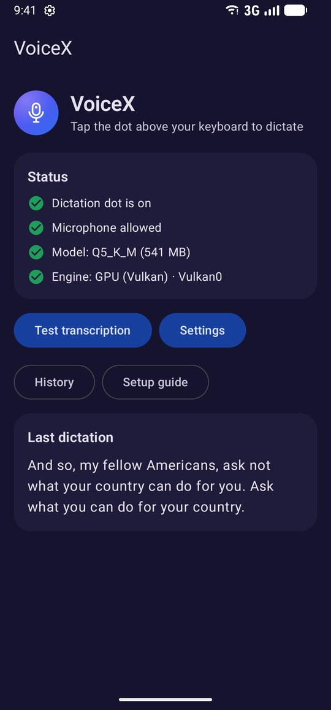
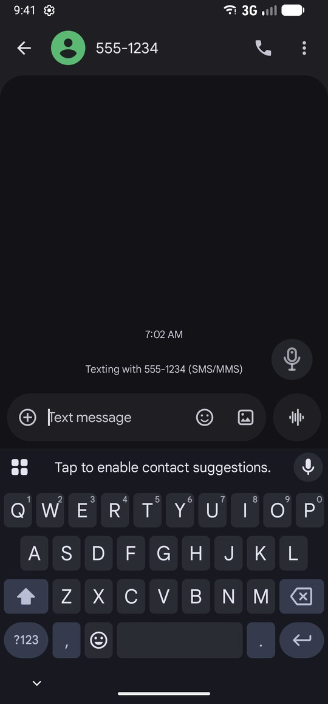
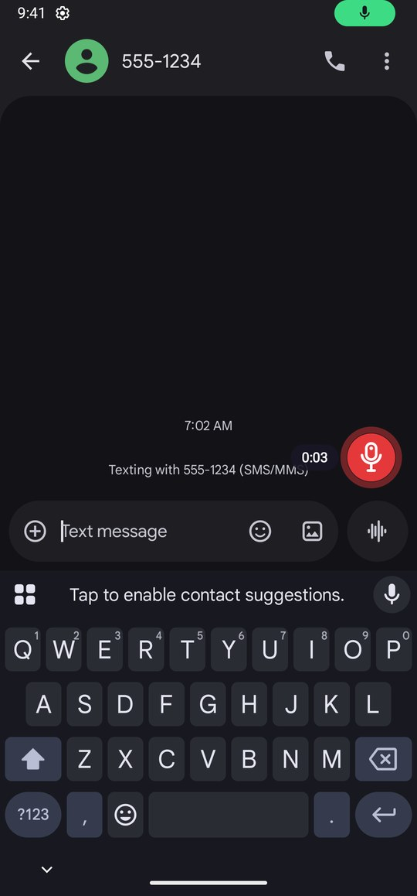
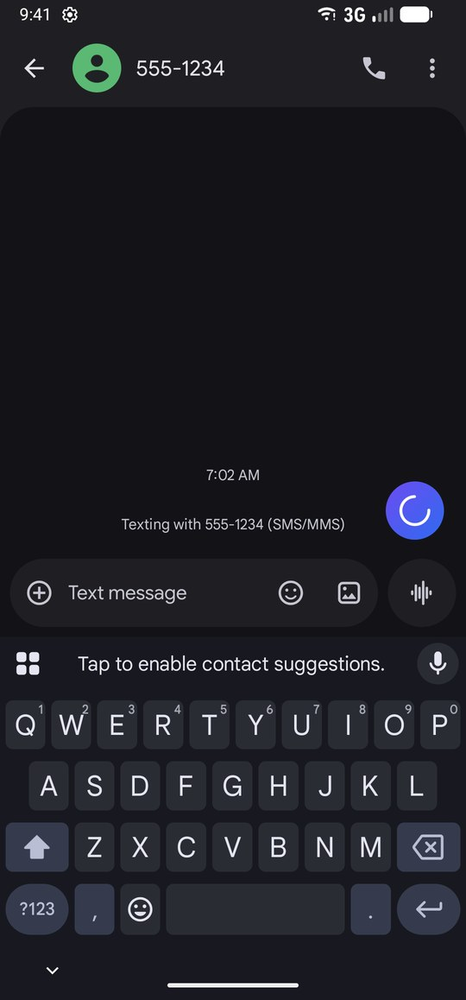
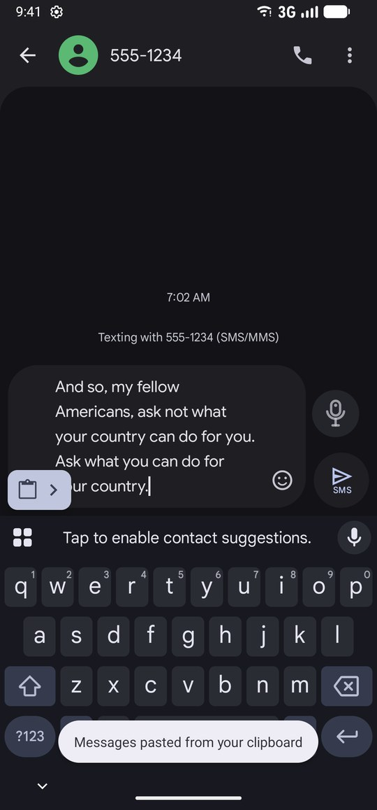
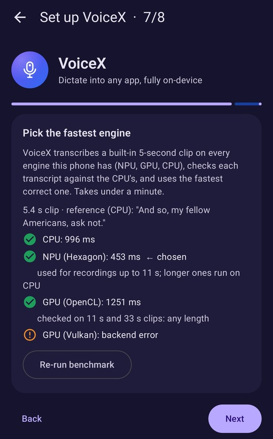
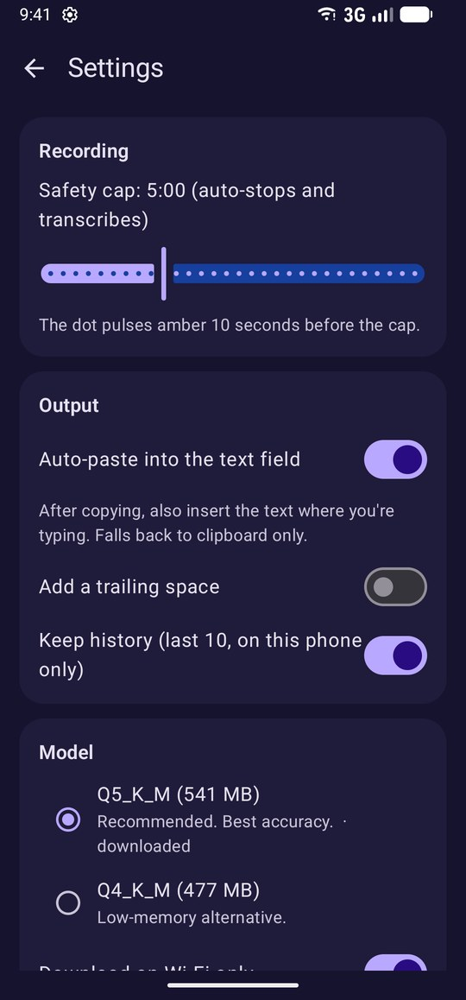
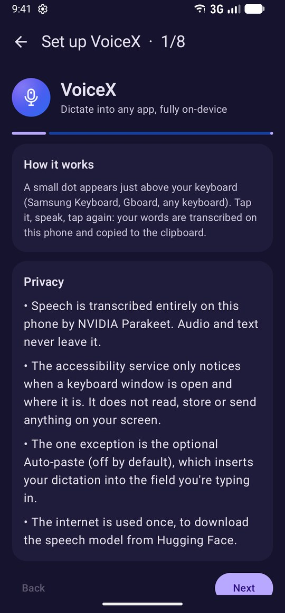
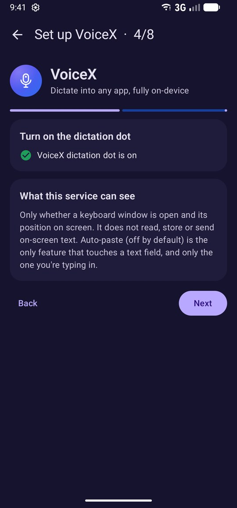
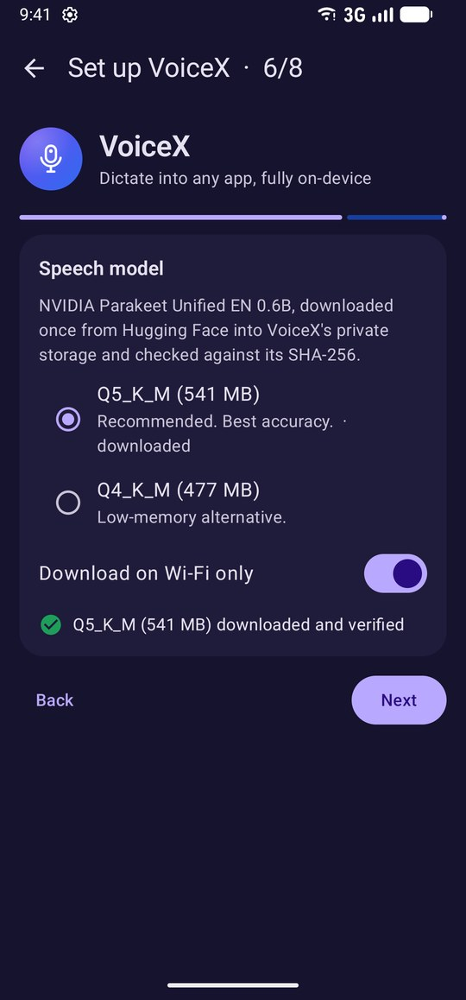

<p align="center">
  
</p>

<h1 align="center">VoiceX</h1>

<p align="center">
  <b>Offline, on-device voice typing for any Android keyboard.</b><br>
  Tap a floating dot, speak, and your words land on the clipboard (or straight into the text field).<br>
  English, plus a second language of your choice from Whisper's ~100: Urdu (اردو) by default, or French, Chinese, Arabic, Hindi… Powered by NVIDIA Parakeet and OpenAI Whisper running locally on the Snapdragon NPU, GPU or CPU. No cloud, no account.
</p>

<p align="center">
  
  
  
  
</p>

<p align="center"><sub>Swipe or scroll sideways to see more ➜</sub></p>
<table>
<tr>
<td align="center" valign="top"><br><sub><b>Status at a glance</b></sub><br><sub>&#8199;&#8199;&#8199;&#8199;&#8199;&#8199;&#8199;&#8199;&#8199;&#8199;&#8199;&#8199;&#8199;&#8199;&#8199;&#8199;&#8199;&#8199;&#8199;&#8199;&#8199;&#8199;&#8199;&#8199;&#8199;&#8199;&#8199;&#8199;&#8199;&#8199;&#8199;&#8199;&#8199;&#8199;&#8199;&#8199;</sub></td>
<td align="center" valign="top"><br><sub><b>A dot above any keyboard</b></sub><br><sub>&#8199;&#8199;&#8199;&#8199;&#8199;&#8199;&#8199;&#8199;&#8199;&#8199;&#8199;&#8199;&#8199;&#8199;&#8199;&#8199;&#8199;&#8199;&#8199;&#8199;&#8199;&#8199;&#8199;&#8199;&#8199;&#8199;&#8199;&#8199;&#8199;&#8199;&#8199;&#8199;&#8199;&#8199;&#8199;&#8199;</sub></td>
<td align="center" valign="top"><br><sub><b>Tap to talk</b></sub><br><sub>&#8199;&#8199;&#8199;&#8199;&#8199;&#8199;&#8199;&#8199;&#8199;&#8199;&#8199;&#8199;&#8199;&#8199;&#8199;&#8199;&#8199;&#8199;&#8199;&#8199;&#8199;&#8199;&#8199;&#8199;&#8199;&#8199;&#8199;&#8199;&#8199;&#8199;&#8199;&#8199;&#8199;&#8199;&#8199;&#8199;</sub></td>
<td align="center" valign="top"><br><sub><b>Transcribed on the phone</b></sub><br><sub>&#8199;&#8199;&#8199;&#8199;&#8199;&#8199;&#8199;&#8199;&#8199;&#8199;&#8199;&#8199;&#8199;&#8199;&#8199;&#8199;&#8199;&#8199;&#8199;&#8199;&#8199;&#8199;&#8199;&#8199;&#8199;&#8199;&#8199;&#8199;&#8199;&#8199;&#8199;&#8199;&#8199;&#8199;&#8199;&#8199;</sub></td>
<td align="center" valign="top"><br><sub><b>Pasted into the text field</b></sub><br><sub>&#8199;&#8199;&#8199;&#8199;&#8199;&#8199;&#8199;&#8199;&#8199;&#8199;&#8199;&#8199;&#8199;&#8199;&#8199;&#8199;&#8199;&#8199;&#8199;&#8199;&#8199;&#8199;&#8199;&#8199;&#8199;&#8199;&#8199;&#8199;&#8199;&#8199;&#8199;&#8199;&#8199;&#8199;&#8199;&#8199;</sub></td>
<td align="center" valign="top"><br><sub><b>Benchmark on a Galaxy S23 Ultra</b></sub><br><sub>&#8199;&#8199;&#8199;&#8199;&#8199;&#8199;&#8199;&#8199;&#8199;&#8199;&#8199;&#8199;&#8199;&#8199;&#8199;&#8199;&#8199;&#8199;&#8199;&#8199;&#8199;&#8199;&#8199;&#8199;&#8199;&#8199;&#8199;&#8199;&#8199;&#8199;&#8199;&#8199;&#8199;&#8199;&#8199;&#8199;</sub></td>
<td align="center" valign="top"><br><sub><b>Settings</b></sub><br><sub>&#8199;&#8199;&#8199;&#8199;&#8199;&#8199;&#8199;&#8199;&#8199;&#8199;&#8199;&#8199;&#8199;&#8199;&#8199;&#8199;&#8199;&#8199;&#8199;&#8199;&#8199;&#8199;&#8199;&#8199;&#8199;&#8199;&#8199;&#8199;&#8199;&#8199;&#8199;&#8199;&#8199;&#8199;&#8199;&#8199;</sub></td>
<td align="center" valign="top"><br><sub><b>Guided setup, privacy first</b></sub><br><sub>&#8199;&#8199;&#8199;&#8199;&#8199;&#8199;&#8199;&#8199;&#8199;&#8199;&#8199;&#8199;&#8199;&#8199;&#8199;&#8199;&#8199;&#8199;&#8199;&#8199;&#8199;&#8199;&#8199;&#8199;&#8199;&#8199;&#8199;&#8199;&#8199;&#8199;&#8199;&#8199;&#8199;&#8199;&#8199;&#8199;</sub></td>
<td align="center" valign="top"><br><sub><b>What the dot service can see</b></sub><br><sub>&#8199;&#8199;&#8199;&#8199;&#8199;&#8199;&#8199;&#8199;&#8199;&#8199;&#8199;&#8199;&#8199;&#8199;&#8199;&#8199;&#8199;&#8199;&#8199;&#8199;&#8199;&#8199;&#8199;&#8199;&#8199;&#8199;&#8199;&#8199;&#8199;&#8199;&#8199;&#8199;&#8199;&#8199;&#8199;&#8199;</sub></td>
<td align="center" valign="top"><br><sub><b>Verified model download</b></sub><br><sub>&#8199;&#8199;&#8199;&#8199;&#8199;&#8199;&#8199;&#8199;&#8199;&#8199;&#8199;&#8199;&#8199;&#8199;&#8199;&#8199;&#8199;&#8199;&#8199;&#8199;&#8199;&#8199;&#8199;&#8199;&#8199;&#8199;&#8199;&#8199;&#8199;&#8199;&#8199;&#8199;&#8199;&#8199;&#8199;&#8199;</sub></td>
</tr>
</table>

---

## Why

Built-in voice typing on most phones either sends audio to a server or is tied to one keyboard. VoiceX works **next to whatever keyboard you already use** (Samsung Keyboard, Gboard, SwiftKey…) and transcribes **entirely on the phone** with [NVIDIA Parakeet Unified EN 0.6B](https://huggingface.co/handy-computer/parakeet-unified-en-0.6b-gguf) for English and [OpenAI Whisper large-v3-turbo](https://huggingface.co/ggerganov/whisper.cpp) for Urdu, both via [transcribe.cpp](https://github.com/handy-computer/transcribe.cpp).

## Features

- **Floating dictation dot.** Appears only while a soft keyboard is open, just above the keyboard's top edge, and disappears with it. Drag it anywhere; its position is remembered separately for portrait and landscape.
- **One tap to talk.** Tap to record (red pulse plus elapsed time), tap again to transcribe. The text is copied to the clipboard, and with **auto-paste** inserted at the cursor of the field you're typing in.
- **Fully offline speech recognition.** Punctuated, capitalised English, and your second language in its own script. Audio and text never leave the device. The internet is used once per language, to download its model.
- **English ⇄ a second language in one long-press.** The second language is transcribed by OpenAI Whisper and is **Urdu** by default; Settings → Language → **Second language** switches it to any of the 99 other languages Whisper knows (Français, 中文, العربية, हिन्दी…), from a searchable list. Long-press the dot and pick **English** or that language. A small badge on the dot shows the current one (EN, UR, FR, ZH…). The menu and badge only appear once the Whisper model is downloaded; until then long-press simply hides the dot. Each model gets its own benchmark, so Whisper runs on whichever engine is fastest and correct for it. Urdu is slower than English: on the S23 Ultra, 11.5 s of Urdu speech is transcribed in about 14 s (see [Second language: accuracy and speed](#second-language-accuracy-and-speed)).
- **Hardware acceleration with automatic selection.** A built-in benchmark tries every engine the phone has (Hexagon NPU, Adreno GPU via OpenCL and Vulkan, CPU), checks each transcript against the CPU's, and uses the fastest correct one. It also checks each accelerator on long audio and routes recordings to an engine verified for that length.
- **Never fails silently.** A backend that won't load or errors out falls back to CPU. An accelerator that returns an empty result for real speech is redone on the CPU automatically. An accelerator that crashes the app outright (a native abort can't be caught) is remembered after the restart and never used with that model again; Whisper is never tried on the Hexagon NPU, where it crashes.
- **Thoughtful details.** Long-press to cancel, "Nothing heard" when you didn't speak (your clipboard stays untouched), a safety cap (30 s to 15 min, default 5 min, with a warning pulse before it), stops cleanly for phone calls and audio-focus loss, and silence trimming before inference.
- **Model download done right.** Resumable (HTTP range requests), Wi-Fi-only by default, and SHA-256 verified before use. Q5_K_M (541 MB, best accuracy) or Q4_K_M (477 MB, less memory).
- **Settings.** Safety cap, auto-paste (+ trailing space), model, engine override and re-benchmark, CPU threads (pinned to the performance cores), keep-loaded vs. load-on-keyboard-open, dot size/opacity, haptics, local history (last 10), and a **Test transcription** screen with timing readout.
- **Diagnostics.** Activity log (successes and problems, with timings but never transcript text), crash reports including native crashes, and the session log, each with one-tap **Copy all**.
- **Guided setup.** A first-run wizard covers permissions, enabling the accessibility service (including Android's *Allow restricted settings* step for sideloaded apps), the model download and the benchmark.

## Results on a Samsung Galaxy S23 Ultra

Snapdragon 8 Gen 2 (Hexagon v73 NPU, Adreno 740 GPU), Android 17, release build, Q5_K_M model. Benchmark clip: 5.4 s of English speech. Reference transcript (CPU): *"And so, my fellow Americans, ask not."*

| Engine | 5.4 s clip | Speed vs. real time | Transcript | Long-audio check (11 s / 33 s) |
|---|---:|---:|---|---|
| **Hexagon NPU** | **453 ms** | **~12×** | ✅ matches CPU (chosen) | ✅ 11 s · ❌ 33 s → used for recordings up to 11 s |
| CPU (4 performance cores) | 996 ms | ~5.4× | ✅ reference | — |
| Adreno GPU (OpenCL) | 1,251 ms | ~4.3× | ✅ matches CPU | ✅ 11 s · ✅ 33 s |
| Adreno GPU (Vulkan) | — | — | ❌ driver backend error, skipped automatically | — |

An earlier run on the same phone (before the long-audio check existed) measured **NPU 444 ms, CPU 742 ms, OpenCL 1,060 ms**, with the same picks.

**What this means in practice:** short dictations (up to 11 s) are transcribed on the NPU at about 12× real time, so a 10-second sentence is ready in well under a second. On the S23 the NPU returned an empty transcript for a real 30 s dictation, which is what led to the long-audio check: longer recordings now go to an engine verified for that length (the CPU here), and any empty accelerator result is redone on the CPU.

<p align="center">
  
</p>

### Second language: accuracy and speed

The second language uses the stock OpenAI Whisper large-v3-turbo (q5_0, 574 MB, in whisper.cpp's format), told which language to expect (no auto-detection, which often mistakes spoken Urdu for Hindi). One model covers every language. Accuracy varies a lot by language: it is strongest for widely spoken ones.

**Urdu (default).** On six sentences from the Google FLEURS Urdu test set, it scored **22 % word error rate and 7.4 % character error rate**: most errors are spelling variants (چھے اگوا for چھے اغوا) rather than wrong words. Accuracy does not depend on the device.

Whisper always encodes a 30-second window, padding short clips with silence, and the encoder is most of the work. VoiceX encodes only the recording plus 2 seconds instead. On the same six sentences that cost 22.4 % WER against 21.9 % for the full window, and was 2.5 times faster on the PC; shorter recordings gain more.

**French and Chinese.** Spot-checked on the PC with three FLEURS sentences each. French came out essentially word for word. Mandarin was right apart from one homophone (钙甲 for 钙、钾). Whisper sometimes writes Chinese in Traditional characters; VoiceX gives it a short Simplified-Chinese starting prompt, which kept all three sentences Simplified.

**Speed.** Whisper runs on the CPU. On the S23 Ultra the NPU crashes with this model, OpenCL returns wrong text and Vulkan reports an error, so the benchmark picks the CPU. Speed is about the same for every language. With the full 30-second window a 3-second Urdu recording took 34 to 45 seconds there. With the shorter window, 11.5 seconds of Urdu speech took **14.0 seconds** (encoder 13.2 s, decoder 0.8 s, 4 CPU threads); time grows with the length of the recording.

## Install

1. Download `VoiceX-1.2.0-release.apk` from [**Releases**](../../releases).
2. Install it with `adb install VoiceX-1.2.0-release.apk`, or open it on the phone and allow your file manager to install unknown apps.
3. Open VoiceX and follow the setup guide:
   1. allow the **microphone** and **notifications**;
   2. turn on the accessibility service **"VoiceX dictation dot"**. If it's greyed out ("Restricted setting"): App info → **⋮** → **Allow restricted settings**, then turn it on;
   3. download the model (541 MB, Wi-Fi);
   4. run the benchmark (about a minute).
4. Open any app, tap a text field, and tap the dot.
5. Optional, a second language: Settings → **Language** → download the Whisper model (574 MB). It is set to Urdu; change it under **Second language** if you speak something else. Then long-press the dot and pick it.

**Requirements:** an arm64 Android 12+ phone with about 1.2 GB free (about 1.8 GB with the second language). NPU and GPU acceleration need a Snapdragon; other phones use the CPU.

## Using the dot

<p align="center">
  
  
  
  
</p>

| Gesture | Action |
|---|---|
| Tap (grey) | Start recording |
| Tap (red) | Stop and transcribe → **Copied** / **Pasted** |
| Long-press while recording | Cancel and discard the audio |
| Long-press when idle | With both language models downloaded: menu with **English** / your second language (**اردو Urdu** by default) / Hide until the keyboard opens again. With one model: hide until the keyboard opens again |
| Drag | Move it (remembered) |
| Orange dot | Something needs attention (no model, mic denied…): tap it to fix |

## Privacy

<p align="center">
  
  
</p>

- The accessibility service listens only for **window changes** and reads only the **type and position** of windows, to find the keyboard. It does **not** read, store or send on-screen text.
- The single exception is the optional **auto-paste** (off by default). Right after a dictation you started, it inserts the text into the focused field: `ACTION_PASTE` first, then `ACTION_SET_TEXT` at the cursor. Password fields are never rewritten.
- Speech is processed in memory and discarded. History (last 10 transcripts) is stored only in app-private storage and can be turned off and cleared.
- Logs record timings and engine names, never transcript text.

## How it works

```
Keyboard opens ──▶ AccessibilityService (TYPE_WINDOWS_CHANGED → TYPE_INPUT_METHOD bounds)
                     └─▶ floating dot (TYPE_ACCESSIBILITY_OVERLAY)
Tap ──▶ foreground service (type: microphone) ──▶ AudioRecord, VOICE_RECOGNITION, 16 kHz mono float
Tap ──▶ trim silence ──▶ AsrEngine (Kotlin) ──JNI──▶ transcribe.cpp ──▶ ggml backend
                                                       ├─ Hexagon NPU (HTP v73 skel via FastRPC)
                                                       ├─ Adreno GPU (OpenCL / Vulkan)
                                                       └─ CPU (tinyBLAS, pinned to the big cores)
       ──▶ clipboard (+ optional ACTION_PASTE / ACTION_SET_TEXT)
```

- ggml backends are built as separate loadable modules, so a phone without a vendor library (e.g. no `libOpenCL.so`) simply skips that backend.
- The CPU path uses ggml's tinyBLAS kernels (the dotprod + fp16 build). Inference runs on a dedicated thread pinned to the fastest cores.
- On a `TRANSCRIBE_ERR_BACKEND` the session is freed, reloaded on CPU and the run retried, as `transcribe.h` documents.

## Build from source

Requirements: Linux x86_64, JDK 17, Android SDK with platform `android-37.0` and build-tools 37, **NDK 30.0.16248370**, **CMake 4.1.2** (SDK package).

```bash
git clone --recurse-submodules https://github.com/saad-git-007/voicex-offline-voice-typing-android.git
cd voicex-offline-voice-typing-android
scripts/fetch-deps.sh              # Vulkan / SPIR-V / OpenCL headers + OpenCL ICD loader
scripts/fetch-deps.sh --hexagon    # optional: Hexagon SDK 6.7 Community Edition for the NPU backend (~3 GB)

# release signing: create keystore.properties (storeFile, storePassword, keyAlias, keyPassword)
PATH=$ANDROID_HOME/cmake/4.1.2/bin:$PATH ./gradlew assembleRelease
# -> dist/VoiceX-1.2.0-release.apk
```

The build applies the patches in `patches/` to the transcribe.cpp submodule (currently one: the short Whisper encoder window used for Urdu). It skips any that are already applied.

Each accelerator is enabled automatically when its SDK is present, and can be switched off with `-Pvoicex.hexagon=false`, `-Pvoicex.opencl=false` or `-Pvoicex.vulkan=false`.

### Tests

```bash
./gradlew :app:testDebugUnitTest   # PCM conversion, silence trim, recording cap, word diff, accelerator policy,
                                   # dot placement, text insertion, benchmark persistence, WAV reader
scripts/host-jni-test.sh           # builds the JNI layer + transcribe.cpp for the host and transcribes the
                                   # bundled clip through the real JNI code in the JVM
```

### Project layout

```
app/src/main/cpp/            CMake build, JNI layer (voicex_jni.cpp), transcribe.cpp submodule
app/src/main/java/com/voicex/app/
  dot/                       accessibility service, floating dot view, placement
  dictation/                 dictation state machine, microphone foreground service
  engine/                    JNI bindings, engine + benchmark, accelerator policy
  audio/                     capture, PCM utilities, recording cap
  model/                     model catalog (pinned SHA-256), resumable downloader
  output/                    clipboard, auto-paste
  ui/                        Compose screens: setup wizard, home, settings, history, test, logs
patches/                     VoiceX changes to transcribe.cpp, applied at build time
branding/                    logo generator (one geometry → SVG, vector drawables, PNGs)
BUILD_NOTES.md               toolchain, CMake changes for Android, backend results, verification details
```

## Credits

- [transcribe.cpp](https://github.com/handy-computer/transcribe.cpp) and [ggml](https://github.com/ggml-org/ggml), MIT
- [NVIDIA Parakeet Unified EN 0.6B](https://huggingface.co/handy-computer/parakeet-unified-en-0.6b-gguf), GGUF by handy-computer. The model has its own license; see the model card.
- [OpenAI Whisper](https://github.com/openai/whisper) large-v3-turbo (MIT), whisper.cpp conversion from [ggerganov/whisper.cpp](https://huggingface.co/ggerganov/whisper.cpp)
- Whisper benchmark clips (Urdu): two sentences from [Google FLEURS](https://huggingface.co/datasets/google/fleurs) (CC BY 4.0), test split
- Benchmark clip: the opening of the JFK inaugural address (US government work, public domain), from transcribe.cpp's samples
